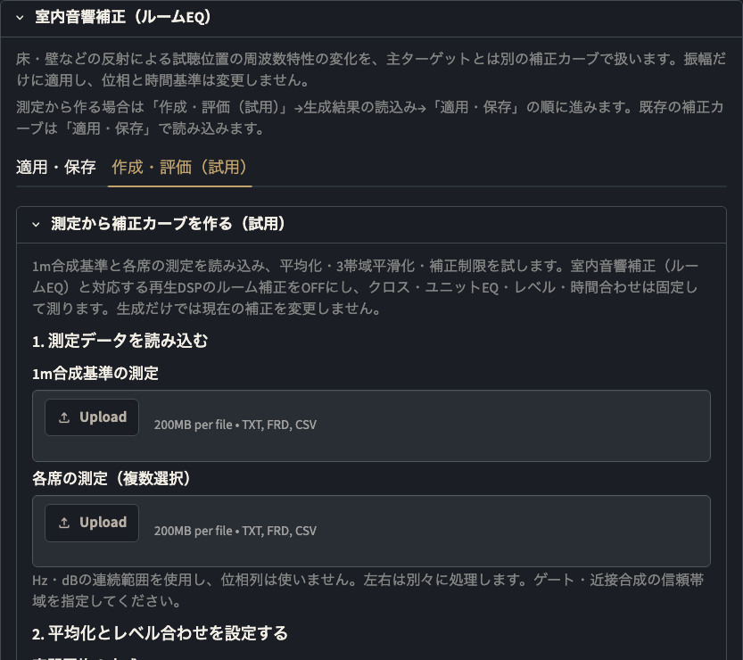
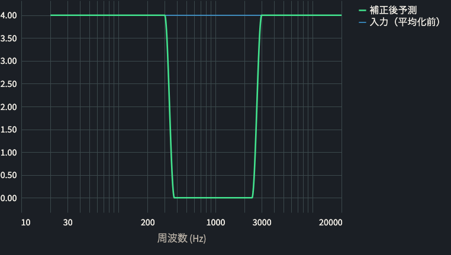

# 室内音響補正（ルームEQ）の操作手順

床・壁などの反射による試聴位置の周波数特性の変化を、主ターゲットとは別の補正カーブで扱います。Free／Proの両版で利用できます。振幅に適用し、位相・時間基準は変更しません。ON/OFFだけではEQ係数は設計されないため、目標を変えた後は手動EQまたは自動EQを更新します。

## 測定から補正カーブを作る（試用）

PhaseEQのガイド測定で「測点ごとに自動保存する」を使う場合は、1m基準と各席のFRDを保存し、以下の基準／各席入力へ読み込みます。測定条件・ゲート・保存手順とOSの制限は[利用ガイドの測点保存](user-guide.md#測点ごとの自動保存)をご覧ください。補正の生成には振幅を使い、FRDの位相列は使用しません。

この節は測定から補正を作る試用機能です。既存のカーブ読込みと併用でき、生成結果を確認してから補正欄へ渡します。

Target画面の「室内音響補正（ルームEQ）」で、目的に合うタブを選びます。

| 目的 | タブと操作 |
|---|---|
| 保存済み・REW作成済みのカーブを使う | 「適用・保存」でカーブを読み込み、方向・内容を確認してONにします。 |
| 基準と各席の測定からカーブを作る | 「作成・評価（試用）」で測定入力→条件設定→生成・比較を行います。 |

測定から作る場合は、**作成・評価 → 生成カーブを補正欄へ読み込む → 適用・保存 → EQ更新・出力 → 再測定**の順に進みます。「適用・保存」を先頭に置き、既存カーブを使う従来の入口を維持しています。

日本語ダークテーマで撮影した試験画面です。作成タブで基準1本と平均化前の各席を入力します。生成カーブは明示的に読み込むまで現在の補正へ反映されません。

1. 室内音響補正（ルームEQ）と、対応する再生DSPのルーム補正をOFFにして測定します。クロスオーバー、ユニットEQ、レベル、時間合わせは調整済みのまま固定します。1m合成基準と、反射を含む各席の測定を別保存してください。
2. 「作成・評価（試用）」の`測定から補正カーブを作る（試用）`で、基準1件と各席1〜32件を読み込みます。各ファイル10MiB以下のTXT／FRD／CSVとし、正周波数Hz・dBの連続範囲を使用します。位相列は使用しません。左右は別々に処理します。
3. 平均方式を選びます。標準は電力平均です。トリム電力平均は5測点以上で、各周波数の上下各20%（最低各1点）を除きます。本当の位置差まで除く場合があるため、通常平均とも比較します。
4. 必要な場合は共通の信頼帯域で全体レベル差を除きます。初期値500〜1500Hzは目安です。補正帯域の初期値300〜3000Hzも、ゲート・近接合成の信頼範囲へ合わせてください。
5. 必要に応じて「平滑化の詳細」を開きます。基準と平均に同じ3帯域Gaussian平滑化を適用します。初期値は境界200Hz／2kHz、幅1/12・1/6・1/3oct FWHM（平滑化重みの半値全幅）です。境界では1/3oct幅で滑らかに混ぜます。
6. 補正帯域、ブースト、カット、測定席の悪化上限を指定します。上限の初期値は0／6／1dBです。帯域端は各1/3octで0dBへ戻します。`補正カーブを生成して確認`で、平均の補正前後予測、生成カーブ、各席のRMSと最大悪化を確認します。「比較する測点」で各席を選び、平均化前の入力と補正カーブ適用後の予測を比較してください。
7. `生成カーブを補正欄へ読み込む`で現在のカーブを置き換え、加算・OFFにします。「適用・保存」へ切り替えて内容を確認してからONにし、必要なEQを更新・出力して再測定してください。生成JSONと、条件・各席結果のJSONも別々に保存できます。

「適用・保存」と「作成・評価（試用）」のタブ往復では、同じ編集対象の測定ファイル・条件・生成結果を保持します。生成結果と実際に使うカーブは別管理です。生成しただけでは現在のカーブを置き換えず、読込み後も自動でONにはしません。

グラフはアプリ共通の表示仕様に従います。測定入力は入力色、補正後予測は結果色、生成カーブは補正色、基準は参照線で表示します。明暗テーマで色調が変わるため、凡例も確認してください。各席の補正後は、レベル合わせ後・平均化と平滑化前の応答へ生成カーブを加えた予測です。実現IIR／FIR応答や再測定結果とは区別します。

一定の+4dB応答を使った動作確認例です。入力線は+4dBのまま、補正後予測は補正帯域内で0dBへ近づき、帯域外で入力へ戻っています。実測したホールの特性ではありません。

処理順は共通範囲へのlog周波数補間→レベル合わせ→空間平均→平滑化→基準−客席平均→補正制限です。補正後表示はデータからの予測であり、実現フィルターや未測定席への保証には使いません。主ターゲット・位相・Delayは維持します。生成だけでは設定を変えず、入力・条件の変更で古い結果を失効させます。生成失敗時は現在の補正を保持します。

生成用の測定・条件・未適用結果は一時データです。再起動、作業セッション復帰、Standalone／Way切替では破棄します。継続評価には元測定、生成JSON、生成条件レポートを保存してください。既に補正欄へ読み込んだカーブは従来どおり作業セッションへ保存されます。

## REWで補正カーブを作る

以下は、1mの基準応答をPhaseEQの設計入力に使い、試聴位置での変化を逆補正する手順です。左右のスピーカーは別々に測定・処理します。元のREW測定は保存し、レベル合わせや演算はコピーで行ってください。

1. **基準特性を測定します。** クロスオーバー・EQ・時間合わせ後、室内音響補正をOFFにします。正面1m、ウーファーとツイーターの中心間の中点を測定軸として、両ユニットを同時に鳴らした合成応答を測ります。IRで最初の反射を確認し、ユーザーがゲートを設定します。低域は近接測定と合成し、信頼できる下限・合成帯域を記録します。
2. **試聴位置を測定します。** スピーカー側の設定とマイク校正条件を固定し、3m・4m・5m・6mなどの各席で、着座時の耳の高さにマイクを置きます。席幅も対象にする場合は左右の席を追加します。床反射を含む応答を調べるため、基準と同じ短いゲートで反射を除去しません。
3. **音量差を除いて空間平均します。** REWの`All SPL`で試聴位置の測定を選び、`Align SPL...`で距離による全体レベル差を除きます。測定同士で信頼でき、極端な山谷が少ない共通帯域を指定し、各カーブを一定のdB量だけ上下します。その後`RMS average`で各席を等しい重みのパワー平均にします。位置間の位相相殺を伴う`Vector average`は、この振幅比較には使いません。基準特性と試聴位置平均も、同じ信頼帯域でレベルを合わせます。
4. **加算用カーブを生成します。** 窓設定済みの基準と試聴位置平均を、それぞれ位相列なしの周波数・dBテキストへ出力し、`Import frequency response`で読み直します。振幅だけを扱うことで、IRの時間基準や演算結果の窓設定の影響を避けます。`Trace arithmetic`でAを基準、Bを試聴位置平均として`A / B`を生成します。振幅比のdB表示は「基準−試聴位置」です。`A − B`は音圧の減算であり、dB値の差にはなりません。
5. **補正の細かさ・帯域・上限を決めます。** まず1/6〜1/3オクターブ程度の平滑化を比較し、複数席に共通する傾向を中心に残します。この幅は目安です。深く狭い谷の持上げは抑え、基準が信頼できない帯域を除外します。必要な上限制限と帯域端の0dBへの滑らかな調整は、書き出した周波数・dBデータを編集して行います。平滑化だけでブースト上限が設定されるわけではありません。
6. **出力・適用・再測定します。** `Export measurement as text`で周波数Hz・振幅dBを出力します。平滑化は出力ダイアログでも指定できます。EQフィルター設定のテキストとは別です。PhaseEQで読み込み、`加算`を選びます。適用をONにして必要なEQを更新・出力し、同じ席で再測定します。平均特性だけでなく、各席の悪化や出力余裕も確認します。

例：試聴位置が基準より4dB盛り上がる帯域は、加算用カーブを−4dBにします。逆に試聴位置が2dB下がる帯域の計算値は＋2dBですが、持ち上げるかどうかは谷の幅と出力余裕で判断します。

REWで作る場合は、平均化・平滑化・補正制限を外部で行います。試用欄では、測定テキストからこれらをまとめて計算できます。REWの操作名や演算時の設定は使用版で確認してください。詳しくは[REW：All SPL・平均・演算](https://www.roomeqwizard.com/help/help_en-GB/html/graph_allspl.html)、[REW：テキスト出力・入力](https://www.roomeqwizard.com/help/help_en-GB/html/file.html)を参照してください。

## 読み込みから比較まで

1. `音の補正・フィルター設計 > 目標特性`を開き、元となるメインターゲットを設定します。
2. `補正カーブを読み込む`でTXT／FRD／CSVを指定します。周波数Hz・振幅dBの列を使います。位相列は使用しません。読み込み直後はOFFです。
3. 次の表で`補正カーブの適用方向`を選びます。
4. `室内音響補正を適用`をONにし、右側の`目標応答`を確認します。OFFで差分のない主目標へ戻ります。
5. 必要なEQを更新し、同音量で試聴・再測定します。

| 差分ファイルの定義 | 1m等の基準応答を設計入力に使う場合 |
|---|---|
| 試聴位置 − 基準 | 減算します |
| 基準 − 試聴位置 | 加算します |

差分を作る前に距離による全体レベル差を除いてください。複数席は同じ正規化と重みで平均します。位相付き応答をそのまま複素平均すると位置間で相殺する場合があるため、音色の空間平均ではパワー平均など目的に合う方法を選びます。差分生成と平均処理はREW等の外部処理、または試用欄で行います。

試聴位置の実測を設計入力に使っている場合は、同じ逆補正を重ねないでください。「主目標＋床反射」を客席測定の比較目標にする方法は、反射を許容する別の用途です。

## 保存・復帰・解除

`補正カーブを保存`で専用の`room_eq.json`を保存します。曲線、ファイル名、ON/OFF、加算／減算が保存され、再読込で復帰します。ONで保存したJSONはONで復帰します。

作業セッションにも差分を保存します。主ターゲットのプリセット登録・目標応答ファイルへの書き出しは差分を含みません。主目標と会場ごとの差分を再利用したい場合は、両方を保存してください。

`補正カーブを解除`は曲線とON状態を消去します。形式が不正なファイルの読み込みでは現在の差分を保持します。旧設定にルームEQ項目がない場合は空・OFFで復帰します。

振幅は対数周波数で補間し、ファイルの範囲外とDCの差分は0 dBです。範囲端で差分が大きい場合は不連続になるため、必要に応じてカーブを0 dBへ滑らかに戻して保存します。位相と時間基準は変更しません。

## 基準測定と試聴位置

今回の2Wayの手順例では、ウーファーとツイーターの中心間の中点を測定軸とし、正面1mにUMIK-2を固定します。各ユニットと合成を同じ位置で測定し、REWの共通音響タイミング基準を維持します。個別にピーク位置を0へ揃えて相対遅延を消去しないでください。

IRで最初の反射を確認し、その手前へユーザーが時間窓を設定します。反射時刻の計算は目安です。窓長で低域の評価範囲が変わるため、低域は近接測定の合成帯域・レベル整合を記録して扱います。近接測定の時間原点をユニット間ディレイへ直接流用しないでください。

試聴位置ではマイクを着座時の耳位置へ置き、各席とその周辺を測定します。1mの準無響基準と客席の反射を含む測定を別保存します。深い干渉ディップを無理に持ち上げず、配置と複数席の応答を確認して、差分側で帯域・平滑化・補正上限を決めてください。

画像付き手順は[画像付き操作マニュアル](manual/PhaseEQ_v2.0.0_画像付き操作マニュアル_日本語.pdf)の目標特性の章にあります。
